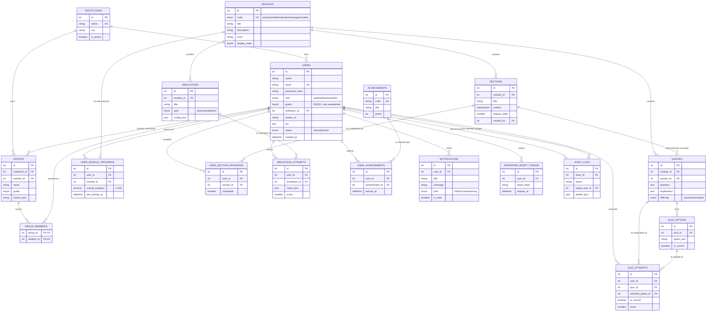

# Modelo relacional de base de datos — FISIOMATHBOT

Este documento describe el modelo de datos diseñado a partir del frontend actual del
proyecto (roles `student`, `teacher`, `admin`; módulos de Física, Matemáticas,
Tecnología y Simulador; quizzes; simulaciones; progreso; perfil con logros; panel de
administración con usuarios/instituciones/estado; notificaciones).

## 1. Motor de base de datos elegido: **MySQL**

| Opción | ¿Por qué sí / no? |
|---|---|
| **MySQL (elegido)** | El dominio es fuertemente relacional: usuarios con roles, módulos con secciones/quizzes/simulaciones, progreso por usuario-módulo-sección, logros N:M, grupos de clase. Todo esto vive naturalmente en tablas con llaves foráneas e integridad referencial. Corre igual en local (XAMPP) y en la nube (Railway), lo que facilita el flujo dev → producción. |
| XAMPP | No es una base de datos, es un paquete de servidores (Apache + **MySQL/MariaDB** + PHP). Se usa como entorno local para MySQL vía phpMyAdmin. Por eso `schema.sql` es 100% compatible con XAMPP: se importa tal cual. |
| Firebase (Firestore) | Es NoSQL orientado a documentos. Obligaría a duplicar datos o desnormalizar todo (progreso, intentos de quiz, roles, membresías de grupo), perdiendo las relaciones y validaciones (`FOREIGN KEY`, `CHECK`, `UNIQUE`) que este dominio necesita. No es la mejor opción para "el modelo relacional" que se pidió. |

**Conclusión:** MySQL en Railway para producción, y el mismo `schema.sql` importado en
XAMPP/phpMyAdmin para desarrollo local. Un solo modelo, dos entornos.

---

## 2. Diagrama entidad-relación (Mermaid)

---

## 3. Diccionario de datos (tablas, atributos y relaciones)

### 3.1 `institutions`
Colegios/instituciones educativas que el administrador gestiona ("Gestionar
instituciones" en `AdminPanel.tsx`).

| Columna | Tipo | Descripción |
|---|---|---|
| id | INT PK | Identificador |
| name | VARCHAR(150) UNIQUE | Nombre de la institución |
| city, address, phone | VARCHAR | Datos de contacto |
| is_active | BOOLEAN | Si sigue vigente en la plataforma |

### 3.2 `users`
Estudiantes, profesores y administradores (superusuario). Corresponde a la interfaz
`User` de `frontend/src/types/index.ts`.

| Columna | Tipo | Descripción |
|---|---|---|
| id | INT PK | Identificador |
| name | VARCHAR(120) | Nombre completo |
| email | VARCHAR(150) UNIQUE | Correo, usado para login |
| password_hash | VARCHAR(255) | Hash bcrypt (nunca la contraseña en texto plano) |
| role | ENUM | `student`, `teacher` o `admin` |
| grade | TINYINT NULL | 9, 10 u 11 — solo aplica a estudiantes |
| institution_id | INT FK → institutions.id | Institución a la que pertenece |
| avatar_url, bio | — | Datos del perfil (`ProfilePage.tsx`) |
| status | ENUM | `active` / `inactive` (toggle del `AdminPanel.tsx`) |
| created_at, updated_at, last_login_at | DATETIME | Auditoría básica |

**Relaciones:** 1 institución → N usuarios · 1 usuario (profesor) → N grupos · 1 usuario
→ N registros de progreso, intentos, logros, notificaciones.

### 3.3 `groups` y `group_members`
Un profesor administra uno o más grupos/cursos (p. ej. "10-A"); cada grupo tiene
varios estudiantes matriculados (relación N:M resuelta por `group_members`). Sostiene
frases del frontend como *"Gestiona tus estudiantes"* en el panel del profesor.

### 3.4 `modules`
Los 4 módulos fijos del frontend (`ModuleType`): Física, Matemáticas, Tecnología,
Simulador. Guardan también `color` e `icon` para pintar las tarjetas del Dashboard.

### 3.5 `sections`
Lecciones de un módulo (interfaz `Section`: `title`, `content`, `order`). Tienen autor
(`created_by`) para que profesores/administradores puedan crear o editar contenido.

### 3.6 `quizzes` + `quiz_options`
Modelan la interfaz `Quiz` (`question`, `options[]`, `correctAnswer`, `explanation`,
`difficulty`). Se **normalizó** el arreglo de opciones en su propia tabla
`quiz_options` con la bandera `is_correct`, en vez de guardar un JSON con el índice de
la respuesta correcta — así se puede validar con `FOREIGN KEY` cuál opción fue elegida
en cada intento y evitar inconsistencias.

### 3.7 `simulations`
Interfaz `Simulation` (`title`, `description`, `type`). `config_json` queda abierto
para guardar los parámetros propios de cada simulación (ángulo inicial, coeficientes,
etc.) sin tener que alterar el esquema cada vez que se agregue una simulación nueva.

### 3.8 `user_module_progress`, `user_section_progress`
Reemplazan la interfaz `Progress` del frontend (`completedSections`, `quizScores`,
`simulationAttempts`, `overallProgress`) separando:
- **Progreso agregado por módulo** (lo que pinta la barra de progreso del Dashboard y
  el `ProgressTracker`).
- **Progreso por sección/lección** (qué lecciones puntuales ya completó el usuario).

### 3.9 `quiz_attempts`, `simulation_attempts`
Histórico de cada intento (permiten reintentos, cálculo de mejor puntaje, y alimentan
`v_user_profile_stats` para las estadísticas del perfil).

### 3.10 `achievements`, `user_achievements`
Catálogo de logros/medallas y cuáles obtuvo cada usuario — corresponde al contador
"Logros" de `ProfilePage.tsx`.

### 3.11 `notifications`
Refleja exactamente la interfaz `AppNotification` de `NotificationContext.tsx`
(`title`, `message`, `kind`, `read`), para que el backend pueda alimentar la campana
del header en vez de usar solo `localStorage`.

### 3.12 `password_reset_tokens`
Soporta el enlace "¿Olvidaste tu contraseña?" ya presente en `Login.tsx`.

### 3.13 `audit_logs`
Trazabilidad de acciones del panel de administración: cambio de rol, activar/
desactivar cuenta, cambios en instituciones — quién lo hizo, a quién, y cuándo.

### 3.14 Vistas (`v_user_profile_stats`, `v_user_module_progress_summary`, `v_admin_user_stats`)
Consultas precalculadas para que el backend no tenga que repetir `JOIN`s complejos al
servir el Dashboard, el Perfil y el Panel de administración.

---

## 4. Reglas de negocio e integridad aplicadas

- `users.email` es `UNIQUE` → no puede haber dos cuentas con el mismo correo.
- `users.grade` solo permite `9`, `10` o `11` (`CHECK`), y es `NULL` para profesores/
  administradores.
- Borrar un módulo elimina en cascada sus secciones, quizzes y simulaciones
  (`ON DELETE CASCADE`), pero borrar un usuario **no** borra los módulos (no aplica).
- Borrar un usuario elimina en cascada su progreso, intentos, logros y notificaciones
  (tiene sentido: son datos que le pertenecen solo a él).
- Si se borra una institución, los usuarios y grupos asociados **no se borran**: su
  `institution_id` pasa a `NULL` (`ON DELETE SET NULL`), para no perder cuentas por un
  error administrativo.
- `overall_progress` está acotado entre 0 y 100 con un `CHECK`.
- Un usuario no puede tener dos veces el mismo logro ni progreso duplicado en el mismo
  módulo/sección (`UNIQUE KEY` compuestas).

## 5. Permisos por rol (a nivel de aplicación/API, no de motor de BD)

| Acción | Estudiante | Profesor | Administrador |
|---|---|---|---|
| Ver/editar su propio perfil (`users`) | ✅ | ✅ | ✅ |
| Ver/editar perfil de otros usuarios | ❌ | Solo su grupo | ✅ (todos) |
| Ver módulos/secciones/quizzes/simulaciones | ✅ (lectura) | ✅ (lectura y edición) | ✅ (lectura y edición) |
| Crear/editar contenido (`sections`, `quizzes`, `simulations`) | ❌ | ✅ | ✅ |
| Registrar su propio progreso e intentos | ✅ | — | — |
| Ver progreso de sus estudiantes (`groups`) | ❌ | ✅ | ✅ |
| Gestionar usuarios/roles/estado (`AdminPanel`) | ❌ | Parcial (sus estudiantes) | ✅ |
| Gestionar instituciones | ❌ | ❌ | ✅ |

Esta tabla es la que debe reflejar el middleware de autorización del backend
(`backend/src/middleware/requireRole.js`).

## 6. Siguientes pasos sugeridos

1. Ejecutar `schema.sql` y `seed.sql` (ver `DEPLOY.md` en la raíz del proyecto).
2. Levantar el backend de ejemplo en `backend/` y verificar que conecta a la BD.
3. Conectar el frontend reemplazando los mocks (`frontend/src/data/*`,
   `frontend/src/services/contentService.ts`, `progressService.ts`) por llamadas reales
   al backend (ya se dejó una base en `frontend/src/services/api.ts`).
